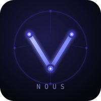

<p align="center">
  
</p>

<h1 align="center">nous</h1>

<p align="center">A containerized <a href="https://github.com/earendil-works/pi">pi</a> coding agent with EnMaaS.</p>

nous combines model routing, research tools, and container images for engineering work.

## Smart features

- **Model routing:** `router/auto` starts on a hosted EnMaaS model. It escalates to a paid model for very complex requests and after hosted retries fail. Set `NOUS_PAID_ESCALATION=off` to block this escalation. See [routing and costs](docs/architecture.md#model-routing).
- **Subagents:** Request a separate model for repository review, wiki research, or Slack thread analysis. A paid advanced reviewer requires interactive confirmation. See [subagents](docs/subagents.md).
- **Knowledge and research:** Search a mounted [OKF 2.0 wiki](docs/wiki.md), use DuckDuckGo, or connect [MCP servers](docs/mcp.md). The wiki can also receive source documents for a separate processor.
- **Window title:** Set `NOUS_TITLE` to name the terminal tab, or use `/title` during a session. See [running](docs/running.md#window-title).
- **Code review:** [Alibaba open-code-review](https://github.com/alibaba/open-code-review) supplies rule-based guidance. The agent then inspects the changes and verifies the findings.
- **Self review:** After a run changes a file, the `self-review` extension adds one reminder before the final answer. The reminder is not a hard block. Set `NOUS_SELF_REVIEW=off` to disable it. See [self review](docs/running.md#self-review).
- **Smaller tool output:** [rtk-oss](https://github.com/rtk-ai/rtk) compresses supported shell output before the agent reads it.
- **Network controls:** [OpenShell](https://github.com/ai-openshell/openshell) enforces an egress policy. A plain Podman run does not apply a policy. Start a sandbox with `./scripts/nous-openshell.sh`. See [OpenShell](docs/openshell.md).

## Image variants

| Image | Contents |
|---|---|
| `ghcr.io/adrianriobo/nous` | pi, the EnMaaS router, subagents, wiki tools, web search, open-code-review, and rtk-oss. |
| `ghcr.io/adrianriobo/nous-productization` | The base image plus [productization skills](https://github.com/opendatahub-io/productization-skills), Python, and engineering CLI tools. |

The productization tools support workflows for Jira, GitLab, Konflux, Slack, Google Workspace, AWS, and infrastructure provisioning. Examples include `gh`, `glab`, `kubectl`, `tkn`, `acli`, and `gws`. Tool installation can vary by build; see [image details](docs/images.md).

## Quick start

Set `ENMAAS_BASE_URL` and `ENMAAS_API_KEY` in your environment.

### Podman

```bash
podman run --rm -it \
  --env ENMAAS_BASE_URL \
  --env ENMAAS_API_KEY \
  ghcr.io/adrianriobo/nous:latest
```

Replace the image name with `ghcr.io/adrianriobo/nous-productization:latest` for productization workflows. Mount `/workspace` to keep work across container runs. See [running nous](docs/running.md) for mounts and credentials.

### OpenShell

OpenShell adds an enforced egress policy. Install OpenShell and clone this repository. Then start the sandbox with the helper script:

```bash
./scripts/nous-openshell.sh
./scripts/nous-openshell.sh --productization
```

The script sets the provider, the policy for your gateway, the sandbox, and the workspace. Pass the same variables that you pass to Podman with `--env-file .env`. See [OpenShell](docs/openshell.md) for the options and the limits.

## Documentation

| Topic | Guide |
|---|---|
| Models, routing, and built-in tools | [Architecture](docs/architecture.md) |
| Image contents, tags, and builds | [Images](docs/images.md) |
| Podman, credentials, and session settings | [Running](docs/running.md) |
| OpenShell sandbox, policy, and workspace | [OpenShell](docs/openshell.md) |
| Wiki search and source ingestion | [Wiki](docs/wiki.md) |
| Journal records and resume | [Journal](docs/journal.md) |
| MCP configuration and tool discovery | [MCP servers](docs/mcp.md) |
| Subagent roles and limits | [Subagents](docs/subagents.md) |
| Builds, tests, and publishing | [CI](docs/ci.md) |
| Agent instructions | [AGENTS.md](AGENTS.md) |
