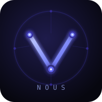

<p align="center">
  
</p>

<h1 align="center">nous</h1>

<p align="center">A production-ready <a href="https://github.com/earendil-works/pi">pi</a> coding agent with Vertex AI, built for secure enterprise environments.</p>

## What you get

**Smart model routing** — automatically picks the right Claude model for each task. Simple questions go to Haiku, complex plans to Sonnet, deep reasoning to Opus. No configuration needed.

**Web search** — DuckDuckGo search built in. The agent searches the web when it needs current information without you having to ask.

**AI code review** — powered by [Alibaba open-code-review](https://github.com/alibaba/open-code-review). Point it at a GitHub PR and it gives you structured, rule-based feedback.

**Kernel-level egress control** — runs inside [NVIDIA OpenShell](https://github.com/NVIDIA/OpenShell), which enforces network policy at the kernel level. The agent can only reach what you explicitly allow.

**Productization skills** — the `nous-productization` image extends the base image with [productization-skills](https://github.com/opendatahub-io/productization-skills): 18 pi-native skills for Jira, GitLab, Konflux, Google Workspace, Slack, and more, plus the tool CLIs they depend on (`gh`, `glab`, `jq`, `yq`, `kubectl`, `kustomize`, `tkn`, `uv`, …). All installed at build time — no runtime setup.

## Image variants

| Image | Tag | Contents |
|---|---|---|
| Base | `ghcr.io/aipcc/nous:latest` | Router, web search, code review |
| Productization | `ghcr.io/aipcc/nous:productization-latest` | Base + 18 skills + tool CLIs |

Both are built from the same `Containerfile` using named targets (`--target nous` / `--target nous-productization`).

## Quick start

```bash
# Base image — interactive
podman run --rm -it \
  --env ANTHROPIC_VERTEX_PROJECT_ID=<your-project> \
  --env CLOUD_ML_REGION=us-east5 \
  -v ~/.config/gcloud/application_default_credentials.json:/sandbox/.config/gcloud/application_default_credentials.json:z \
  ghcr.io/aipcc/nous:latest

# Productization image — with Jira/GitLab/Konflux skills
podman run --rm -it \
  --env ANTHROPIC_VERTEX_PROJECT_ID=<your-project> \
  --env CLOUD_ML_REGION=us-east5 \
  -v ~/.config/gcloud/application_default_credentials.json:/sandbox/.config/gcloud/application_default_credentials.json:z \
  ghcr.io/aipcc/nous:productization-latest

# Or pipe a task
echo 'Review PR https://github.com/OWNER/REPO/pull/42' | \
  podman run --rm -i \
  --env ANTHROPIC_VERTEX_PROJECT_ID=<your-project> \
  --env CLOUD_ML_REGION=us-east5 \
  -v ~/.config/gcloud/application_default_credentials.json:/sandbox/.config/gcloud/application_default_credentials.json:z \
  ghcr.io/aipcc/nous:latest
```

## Credentials

nous needs two env vars and Google credentials:

| Variable | Description |
|---|---|
| `ANTHROPIC_VERTEX_PROJECT_ID` | Your GCP project ID |
| `CLOUD_ML_REGION` | Vertex AI region, e.g. `us-east5` |

For credentials, mount your ADC file (shown above) or set `GOOGLE_APPLICATION_CREDENTIALS` to a service account JSON path.

## Internal CA bundles

If your MCP servers or internal services use a private CA, mount the bundle at startup:

```bash
-v /path/to/ca-bundle.crt:/run/secrets/ca-bundle.crt:z
```

nous exports `NODE_EXTRA_CA_CERTS` automatically so all Node.js traffic trusts the bundle — no root access required. If you set `NODE_EXTRA_CA_CERTS` in your env file, that value takes precedence.

## External MCP servers

Mount an `mcp.json` to inject additional MCP servers at startup:

```bash
-v /path/to/mcp.json:/run/secrets/mcp.json:z
```

The file follows the standard MCP format:

```json
{
  "mcpServers": {
    "my_server": {
      "url": "https://my-mcp-server.example.com/mcp",
      "headers": { "Authorization": "Bearer <token>" }
    }
  }
}
```

At startup nous merges these entries into the agent's MCP config, calls `tools/list` on each HTTP server, and registers every discovered tool as a first-class pi function named `<serverName>_<toolName>`. The discovery runs before pi initialises so the tools appear in pi's `<functions>` block from the first turn — no image rebuild required, no codemode needed.

Both MCP transport protocols are supported automatically:
- **Streamable HTTP** (MCP spec 2025-03-26) — direct POST with session negotiation via `Mcp-Session-Id`
- **HTTP+SSE** (MCP spec 2024-11-05) — GET-based SSE stream with a separate message endpoint

### Routing

nous reads the `instructions` field from each server's `initialize` response and prepends it to every tool description. pi uses this to prefer domain-specific tools over `web_search` without any extra configuration.

To override or sharpen the routing signal, add a `hint` field alongside the server URL:

```json
{
  "mcpServers": {
    "my_server": {
      "url": "https://my-mcp-server.example.com/mcp",
      "headers": { "Authorization": "Bearer <token>" },
      "hint": "Use for any questions about <your domain>"
    }
  }
}
```

The `hint` takes precedence over the server's own `instructions`. No rebuild needed — change the mounted `mcp.json` and restart the container.

## Build your own

```bash
git clone https://github.com/aipcc/nous
make build
```

## Go deeper

| Topic | Doc |
|---|---|
| Running with podman and OpenShell | [docs/running.md](docs/running.md) |
| CI/CD workflows and mock Vertex server | [docs/ci.md](docs/ci.md) |
| Router logic, model tiers, tools, egress architecture | [AGENTS.md](AGENTS.md) |
