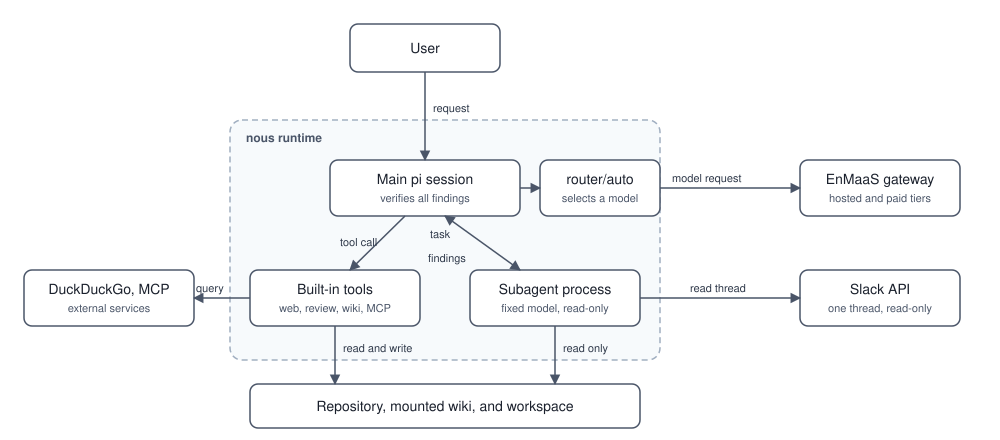

# Architecture

nous extends [pi](https://github.com/earendil-works/pi) with an EnMaaS provider, a virtual model router, and tools. The extension lives in [`context/router/`](../context/router/).

## System overview

  

A child uses its fixed model through EnMaaS. It does not use `router/auto`. A child and the main session share the filesystem, operating-system identity, and network policy. The child tool list is not a security sandbox.

OpenShell can apply a network policy around the runtime. A plain Podman run does not apply that policy. See [network boundary](#network-boundary).

## Model routing

The default session model is `router/auto`. At startup, nous queries the EnMaaS model list. It keeps the listed tier candidates and the locally pinned hosted models. If discovery fails, it uses the configured fallback tiers.

The router selects models from the discovered tiers. It uses a cheap model for trivial requests and after a write-like tool call. For a nontrivial planning request, it selects the **last available tier**. A retry selects the next tier up, subject to the last tier.

The configured tier order is:

1. DeepSeek V4.1 Flash — hosted model.
2. GLM 5.3 — hosted model.
3. GPT 5.4 Mini — paid model.
4. GPT 6.1 Terra — paid model.

**Cost warning:** When a paid model is the last discovered tier, normal nontrivial planning can select it. Manual tier selection and retries can also select paid models. The confirmation for a paid subagent does not apply to the main router. Check gateway billing and the discovered tiers before use.

The hosted models are pinned because the gateway model list can omit them. For a new route, `low`, `medium`, and `high` thinking selections map to tier positions. The router passes thinking as `off` to the selected model. The gateway provides the actual billing information; pi's catalog reports zero cost. The router uses the Responses API for OpenAI-family models. The hosted models use chat completions.

The router's phase and complexity decisions are heuristics. Trivial requests have fewer than 20 words and no matching technical keyword. A write-like tool call can switch a continuation to the implementation phase. These rules do not guarantee the best model for every task. See [`model.ts`](../context/router/model.ts) and [`enmaas.ts`](../context/router/enmaas.ts) for the current rules and catalog.

## Subagents

The `subagent` tool starts a separate pi process for an explicitly requested task. Roles use fixed models and role-specific tools. The main session keeps `router/auto`. The advanced reviewer requires confirmation for each paid invocation.

A child shares the parent filesystem, operating-system identity, and network policy. Its tool list is not a security sandbox. See [subagents](subagents.md) for roles, limits, and credentials.

## Built-in tools

| Tool or integration | Purpose |
|---|---|
| `web_search` | Search DuckDuckGo Lite for current information. Network access must permit the endpoint. |
| `code_review` | Run Alibaba open-code-review in delegate mode. Review the resulting guidance against the source. |
| Wiki tools | Search or read a mounted wiki. Save source documents for a separate processor. See [wiki](wiki.md). |
| MCP discovery | Register tools from configured HTTP MCP servers. See [MCP servers](mcp.md). |
| rtk-oss | Compress supported shell command output before pi receives it. Savings depend on the command and output. |

The image also includes [`context/APPEND_SYSTEM.md`](../context/APPEND_SYSTEM.md). It provides common instructions for communication, work locations, wiki search, and code review. Task-specific instructions can add context.

## Network boundary

OpenShell policies can restrict network access for the sandbox. The standard policy permits EnMaaS and GitHub. Separate examples permit DuckDuckGo or Slack. Configure additional services when needed. A Podman run alone does not apply OpenShell policies. See [running nous](running.md#nvidia-openshell).
